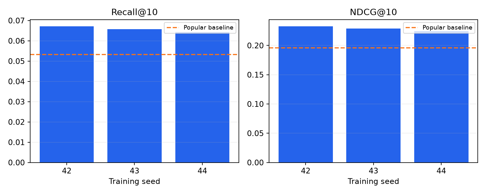
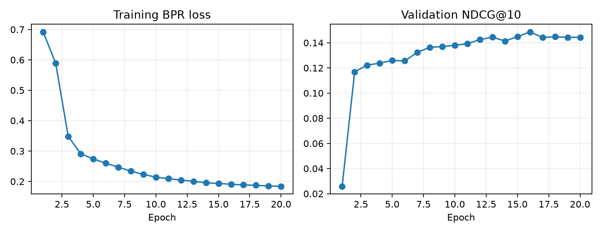

# PyTorch 电影推荐系统：实际实验结果

本报告来自已执行的真实 MovieLens 1M 实验。模型和实验由 AI 辅助实现；个人简历应准确说明自己的学习、修改与分析贡献。

## 数据与任务

读取 1,000,209 条评分、6,040 位用户、3,706 部实际被评分电影。
按全局时间划分：训练 800,164、验证 100,024、测试 100,021 条；同时间戳不跨窗口。
训练目录 3,662 部电影；最终合格评估用户 955 位。
评分 >=4 为正向标签，主评估要求用户至少五个训练正向项目；过滤全部训练期已评分电影。用户画像冻结在训练截止状态，验证/测试分别评价。
推荐候选为训练目录中的全部未评分电影。新用户、新电影不进入主排名指标，需要结合过滤人数理解结论范围。

## 模型与选型

模型是用户/电影 ID embedding 的点积，使用 BPR 排序损失与 Adam。
先比较两个维度的验证结果，锁定选择之后才执行最终测试；部署种子事先固定为 42。

| 维度 | 验证 NDCG@10 | 验证 Recall@10 | 最佳 epoch |
|---:|---:|---:|---:|
| 16 | 0.137901 | 0.055611 | 20 |
| 32 | 0.148661 | 0.068605 | 16 |

选中维度：**32**。其余参数见 experiment_plan.json，未按测试表现挑选种子。

## 测试结果

标准差使用三种子的样本标准差；热门基线为同一测试协议。

| 指标 | 热门基线 | MF 三种子均值 ± 标准差 | 均值绝对变化 |
|---|---:|---:|---:|
| Recall@10 | 0.053273 | 0.065752 ± 0.001389 | +0.012479 |
| NDCG@10 | 0.195653 | 0.228696 ± 0.003995 | +0.033043 |
| CatalogCoverage@10 | 0.035227 | 0.106772 ± 0.008206 | +0.071546 |

| 随机种子 | 最佳 epoch | Recall@10 | NDCG@10 |
|---:|---:|---:|---:|
| 42 | 16 | 0.067111 | 0.232576 |
| 43 | 18 | 0.065812 | 0.228916 |
| 44 | 14 | 0.064335 | 0.224596 |

三种子平均 NDCG 的相对变化为 +16.89%；绝对变化为 +0.033043。

## 不确定性与分组

部署模型（种子 42）相对热门的 NDCG 配对差值为 +0.036923，逐用户 bootstrap 的近似 95% 区间为 [+0.027719, +0.046067]。
区间整体大于零，支持这次合格评估人群上的平均改善。
该区间衡量固定模型的用户抽样不确定性；上表的三种子标准差另行描述训练波动，两者不能混为同一个区间。
用户活跃度分组和种子 42 的详细报告见 [report.md](report.md)。

## 失败案例观察

- 用户 1274：合格未来正向标签 151 个，Recall@10=0.000000，NDCG@10=0.000000。该例说明平均改善仍可能伴随个体推荐失败。
- 用户 5878：合格未来正向标签 142 个，Recall@10=0.000000，NDCG@10=0.000000。该例说明平均改善仍可能伴随个体推荐失败。

## 推理性能

CPU、单线程、并发 1、预热 20 次后测量 200 次请求：p50 **1.194 ms**，p95 **1.304 ms**。
物品向量缓存；包含用户编码、过滤、全目录打分、排序与结果构造；不含模型/数据加载、HTTP 和磁盘读写。该数字是本机热推理测量。

## 实验限制

- 主指标只代表满足训练历史和目录条件的人群；新用户回退热门，新电影需要额外内容模型。
- 数据为历史电影评分，存在曝光与选择偏差，无法从这次离线实验推断业务 CTR、收益或因果提升。
- 三种子与单个时间切分仍有限，后续可使用更多时间窗口和模型进行验证。

## 环境与复现

PyTorch 2.14.1+cu130；CUDA 13.0；训练显卡 NVIDIA GeForce RTX 5070 Ti Laptop GPU。
评分文件 SHA256：`506d64ca44484487c11dc2d9a28de5c54948213e6b96285e298afe28d6ea4e0f`。

模型权重与运行文件保存在 runs/。按 README 的下载和复现命令执行即可重新训练；原始数据按 GroupLens 条款从官网下载。

数据：[MovieLens 1M](https://grouplens.org/datasets/movielens/1m/)；方法：[BPR 原论文](https://arxiv.org/abs/1205.2618)。

## 图表

