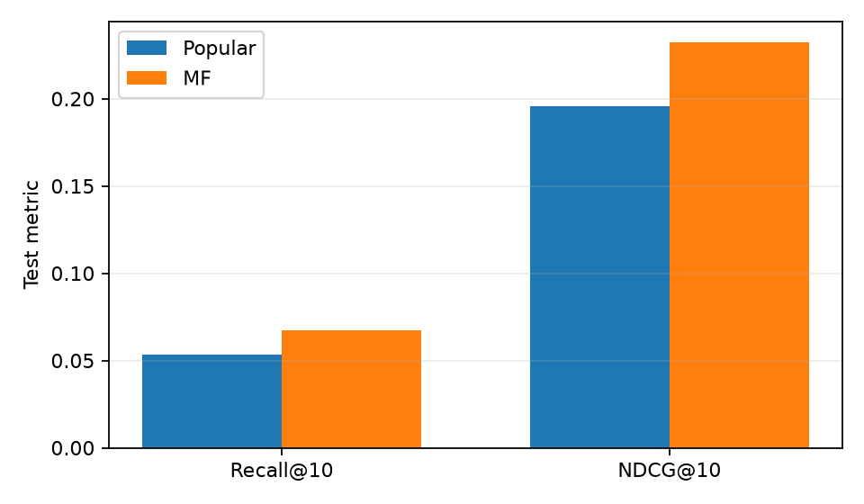

# MF 推荐系统实验报告

本文由运行文件生成。解释与个人贡献需要你补充。

| 指标 | 热门基线 | MF | 绝对变化 |
|---|---:|---:|---:|
| Recall@10 | 0.053273 | 0.067111 | +0.013837 |
| NDCG@10 | 0.195653 | 0.232576 | +0.036923 |
| CatalogCoverage@10 | 0.035227 | 0.109776 | +0.074549 |

评估用户数：955；训练目录：3662 部电影。
时间边界：{"valid_start_timestamp": 975768738, "test_start_timestamp": 978133414}。

## 固定模型的逐用户配对 bootstrap

NDCG 平均差值（MF 减热门）：0.036923。
近似 95% 区间：[0.02771882791812894, 0.04606650205361635]。
仅衡量固定模型的用户抽样不确定性；首版单种子，未完整衡量训练波动。

## 按训练期正向评分数分组

| 训练正向项目数 | 用户数 | 热门 NDCG | MF NDCG |
|---|---:|---:|---:|
| 5-19 | 84 | 0.241980 | 0.294652 |
| 20-49 | 179 | 0.189636 | 0.225821 |
| 50+ | 692 | 0.191586 | 0.226789 |

## 范围与局限

全局时间切分、训练历史冻结、训练目录全候选评价，主指标限制为合格用户与电影。
过滤情况：{"positive_rows_total": 54452, "excluded_new_user_rows": 10812, "eligible_positive_rows": 41558, "excluded_insufficient_history_rows": 2041, "excluded_new_item_rows": 41}。
评分偏好不是点击日志；离线差异不能直接推断业务 CTR 或因果效果。

## 复现信息

配置：`{"ratings": "data\\ml-1m\\ratings.dat", "movies": null, "demo": false, "genres": false, "architecture": "mf", "dim": 32, "epochs": 20, "batch_size": 1024, "learning_rate": 0.001, "weight_decay": 1e-05, "seed": 42, "device": "cuda", "k": 10, "min_positives": 5, "patience": 4, "threads": 4, "validation_only": false, "out": "runs\\final"}`
PyTorch：2.14.1+cu130；设备：cuda。
数据 SHA256：506d64ca44484487c11dc2d9a28de5c54948213e6b96285e298afe28d6ea4e0f。

## 需要自己补充

- 验证集为什么选这个维度？
- 哪类用户更难推荐？列两个实际案例。
- 模型改善或未改善的可能原因。
- 你独立重写、修改、检查或分析了哪些部分？

## 图表

